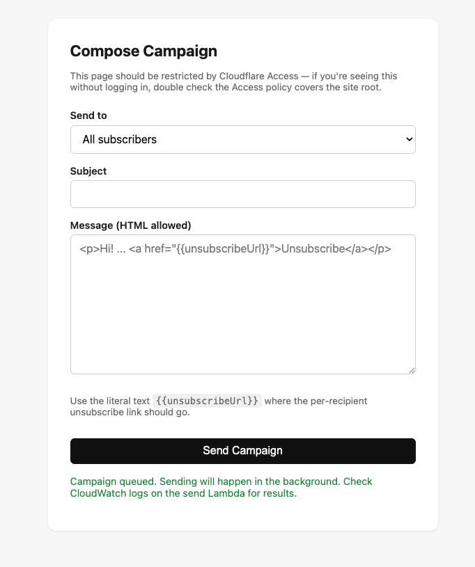

# Bulk Email Tool

A serverless tool for sending bulk email campaigns to a self-managed
subscriber list, with named groups and working unsubscribe support — built
to get around Gmail's sending limits for a small business (originally: a
tennis coach's client list), and to show a real AWS + TypeScript infra
project for job applications.

**There is no public signup page.** Recipients are loaded from a CSV or
Excel file you already have, via an import script — they never visit any
part of this tool except the unsubscribe link in an email they received.

## The compose UI

The admin-only compose page (a Vite + vanilla-TS static site on Cloudflare
Pages, gated behind Cloudflare Access) — pick a list, write an HTML message
with a `{{unsubscribeUrl}}` placeholder, and send:



## Architecture

```
frontend/  Vite + TS static site → Cloudflare Pages
             index.html        compose/send tool (gate with Cloudflare Access)
             unsubscribe.html  unsubscribe confirmation (must stay public)
infra/     AWS CDK (TypeScript) — defines everything below
lambdas/   Three Lambda handlers (TypeScript)
scripts/   CSV/Excel → DynamoDB import script (run locally, not deployed)
shared/    Types + AVAILABLE_LISTS shared between lambdas/frontend/scripts
```

- **DynamoDB** — one table, `email` as partition key, storing `subscribed`,
  `unsubscribeToken`, `createdAt`, and `lists` (which named groups a
  subscriber belongs to).
- **`npm run import-subscribers`** — reads a CSV or Excel file and loads
  rows into DynamoDB. This is how subscribers get in — there's no API
  route for it. Safe to re-run with an updated file (see script header
  comment for exactly how it handles existing/unsubscribed people).
- **GET /unsubscribe** (Lambda + API Gateway) — public. Validates the
  token against DynamoDB and flips `subscribed` to false.
- **POST /campaigns** (Lambda + API Gateway, admin-only) — called by the
  compose page. Checks a shared secret (`x-admin-key` header), then
  asynchronously invokes the send Lambda and returns immediately. Needed
  because API Gateway HTTP APIs hard-cap requests at 29 seconds, and a
  1,500-recipient send takes longer than that.
- **Send campaign** (Lambda, invoked async by `/campaigns` or directly via
  `aws lambda invoke`) — scans subscribers (optionally filtered to one
  named group), sends via SES, embeds each recipient's personal
  unsubscribe link.
- **SES** — handles actual delivery; DKIM/SPF configured via
  `ses.EmailIdentity` in the CDK stack.

## Mailing lists / groups

Defined in `shared/src/types.ts` as `AVAILABLE_LISTS` — edit that array to
match your actual groups (e.g. `["juniors", "adults", "private-lessons"]`).
It drives the dropdown on the compose page. The import script will still
import list names not in this array, but flags them since they won't show
up as a dedicated dropdown option.

## Cost

At ~1,500 recipients/month this runs close to free: SES gives 3,000 free
message charges/month for your first 12 months (then $0.10/1,000 after),
and Lambda / DynamoDB / API Gateway all comfortably fit inside AWS's free
tier at this volume.

